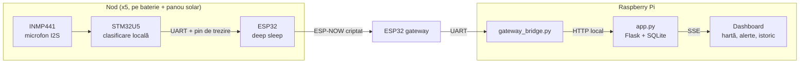

# SonicGrid

Rețea de senzori acustici autonomi care recunosc pe loc ce s-a auzit și arată operatorului, pe o hartă în timp real, **ce** s-a întâmplat și **unde**. Fără camere și fără să trimită sunetul înregistrat.

Fiecare nod clasifică sunetul local în 6 categorii: **țipăt, sticlă spartă, claxon, alarmă, grup de persoane, trafic**. Din nod pleacă doar rezultatul (clasa, procentele pe clase și nivelul în dB), niciodată audio.

<!-- Pune aici o captură a dashboard-ului:  -->

## Cum funcționează



1. **STM32U5** ascultă continuu microfonul și rulează modelul. Când detectează un eveniment, ridică un pin și trezește ESP32-ul.
2. **ESP32-ul de pe nod** stă în deep sleep. Se trezește la eveniment (sau periodic, pentru heartbeat), citește rezultatul pe UART și îl trimite prin ESP-NOW.
3. **Gateway-ul ESP32** primește pachetele de la toate nodurile și le scrie ca JSON pe UART-ul Raspberry Pi-ului.
4. **`gateway_bridge.py`** elimină duplicatele, grupează evenimentele auzite de mai multe noduri în aceeași fereastră de timp (confirmare) și le trimite serverului.
5. **`app.py`** salvează totul în SQLite și împinge datele în browser prin Server-Sent Events, deci alerta apare pe hartă imediat ce ajunge la server.

## Hardware

| Componentă | Rol |
|---|---|
| NUCLEO-U5A5ZJ-Q (STM32U5) | captură audio și clasificare pe nod |
| INMP441 | microfon digital I2S |
| ESP32 (WROOM) | radio ESP-NOW pe nod și ca gateway |
| 2 × LiFePO4 18650 (3.2 V, 2000 mAh) + modul de încărcare + panou solar | alimentare autonomă |
| Raspberry Pi (testat pe Pi 5) | server, bază de date, dashboard |

Cost actual: aproximativ **290 lei pe nod**.

## Structura proiectului

```
sonicgrid/
├── firmware/
│   ├── stm32/                 clasificarea pe STM32U5 (STM32CubeIDE)
│   ├── nod_stm/               ESP32 de pe nod (nod_stm.ino)
│   └── gateway_espnow/        ESP32 gateway (gateway_espnow.ino)
├── server/
│   ├── app.py                 server Flask: API, SSE, istoric, export CSV
│   ├── gateway_bridge.py      UART -> server, deduplicare, confirmare între noduri
│   ├── nodes.json             numele și coordonatele nodurilor
│   ├── sonicgrid_web/         login, roluri (admin / operator), pagini legale
│   ├── templates/             dashboard (index.html), istoric, pagini legale
│   ├── static/vendor/         Leaflet, pentru rulare fără internet
│   ├── legal.py               datele din paginile legale
│   └── sonicgrid.service      pornire automată cu systemd
└── tools/
    ├── clasificator.py        colectare de date pentru antrenare (vezi mai jos)
    └── sg_features.py         același front-end audio ca pe placă, în numpy
```

## Instalare

### 1. Firmware

**STM32:** deschide proiectul din `firmware/stm32/` în STM32CubeIDE și încarcă-l pe placă.

**ESP32 (nod și gateway):** Arduino IDE cu core-ul ESP32 3.x.

Pe fiecare **nod** (`nod_stm.ino`) setezi:
- `NODE_ID`: unic pe fiecare placă (`n1` ... `n5`);
- `GATEWAY_MAC`: MAC-ul gateway-ului, afișat de acesta la pornire;
- `MOD_LIVE`: `1` trimite nivelul la 1.5 s (vumetru fluid, consum mare), `0` o dată pe minut (pentru baterie).

Pe **gateway** (`gateway_espnow.ino`) treci în `NODURI[]` MAC-ul fiecărui nod; nodul îl afișează pe serial la fiecare trezire.

Pe ambele, `CRIPTARE`, `ESPNOW_PMK`, `ESPNOW_LMK` și `ESPNOW_CHANNEL` trebuie să fie **identice**. Dacă cheile diferă, nodul primește tot ACK, dar gateway-ul aruncă pachetele fără niciun mesaj.

Cablare nod (STM32 ↔ ESP32): TX/RX pe UART, un pin de trezire (pin RTC pe ESP32) și GND comun.

Cablare gateway (ESP32 ↔ Pi):

| ESP32 | Raspberry Pi |
|---|---|
| GPIO17 (TX2) | GPIO15 / RXD (pin 10) |
| GPIO16 (RX2) | GPIO14 / TXD (pin 8) |
| GND | GND (pin 6) |
| VIN | 5 V (pin 2) **sau** USB, niciodată amândouă |

### 2. Raspberry Pi

Activează UART-ul de pe GPIO și oprește consola serială de pe el:

```bash
# în /boot/firmware/config.txt
enable_uart=1
dtoverlay=disable-bt          # Pi 3/4; pe Pi 5: dtparam=uart0=on

# în /boot/firmware/cmdline.txt: șterge console=serial0,115200
sudo systemctl disable --now serial-getty@ttyAMA0.service
sudo usermod -aG dialout $USER
sudo reboot
```

Instalează serverul:

```bash
cd ~/sonicgrid
python3 -m venv venv
source venv/bin/activate
pip install flask waitress pyserial requests
```

Creează primul cont:

```bash
python -m sonicgrid_web add <nume> admin
```

Pornește serverul și bridge-ul:

```bash
waitress-serve --threads=24 --host=0.0.0.0 --port=5000 app:app
python gateway_bridge.py /dev/ttyAMA0
```

Pentru pornire automată: `sudo cp sonicgrid.service /etc/systemd/system/ && sudo systemctl enable --now sonicgrid` (și la fel pentru bridge).

Dashboard: `http://<ip-pi>:5000`. Pentru HTTPS în spatele nginx, vezi `setup_https.sh`.

### 3. Pozițiile nodurilor

Editează `nodes.json` cu coordonatele reale (în Google Maps: clic dreapta pe punct, primul rând copiază latitudinea și longitudinea), apoi `sudo systemctl restart sonicgrid`.

## Dashboard

- **Hartă live:** nivelul fiecărui nod, alertele și clasa dominantă, actualizate prin SSE.
- **Alerte:** banner, nod evidențiat pe hartă, confirmare când același sunet e auzit de mai multe noduri.
- **Istoric:** alerte și nivel pe nod, pe intervale de la o oră la 30 de zile, cu export CSV.
- **Conturi:** roluri `admin` și `operator`, parole hash-uite, pagini de termeni și confidențialitate.

## API

| Rută | Metodă | Descriere |
|---|---|---|
| `/api/ingest` | POST | o citire de la un nod (folosită de bridge) |
| `/api/alert` | POST | o alertă (folosită de bridge) |
| `/api/state` | GET | starea curentă a tuturor nodurilor |
| `/api/stream` | GET | aceeași stare, împinsă live (SSE) |
| `/api/alerts` | GET | ultimele alerte |
| `/api/istoric/alerte`, `/api/istoric/nivel` | GET | istoric filtrat |
| `/api/export.csv` | GET | export CSV (`?ce=alerte` sau `?ce=citiri`) |
| `/health` | GET | verificare rapidă |

## Configurare

| Unde | Ce | Implicit |
|---|---|---|
| `app.py` | `ALERT_ACTIVE`: cât rămâne o alertă evidențiată pe hartă | 5 s |
| `app.py` | `OFFLINE_AFTER`: după cât timp fără date un nod apare offline | 150 s |
| mediu | `SONICGRID_SSE_MAX`: câte dashboard-uri primesc flux live (restul trec pe cereri la 1 s) | 2 |
| mediu | `SONICGRID_NODE_KEY`: cheie cerută bridge-ului, dacă serverul e expus în afara rețelei locale | nesetată |
| `gateway_bridge.py` | `WINDOW_MS`: fereastra în care două detecții sunt același sunet | 800 ms |

## Confidențialitate

Pe calea normală (nod → gateway → server) **nu circulă și nu se salvează audio**: din nod pleacă doar clasa, procentele pe clase și nivelul în dB.

`tools/clasificator.py` este o excepție intenționată: e un instrument de colectare a datelor pentru antrenarea modelului, care **primește și salvează fragmente audio**. Folosește-l doar în teste, cu acordul persoanelor înregistrate. Nu face parte din sistemul livrat.

## Stadiu și limitări

- Prototip cu 5 noduri, testat pe campusul Politehnicii din București.
- Modelul are nevoie de mai multe date înregistrate în scenarii reale.
- Fiecare nod trebuie să fie în raza gateway-ului (ESP-NOW nu face încă transmisie din nod în nod).
- În `MOD_LIVE` consumul ESP32-ului crește de câteva ori.

## Ce urmează

- PCB propriu pentru nod, cu STM32U5, microfon și încărcare solară pe aceeași placă.
- ESP-NOW din nod în nod, pentru arii mai mari.
- Antrenarea modelului pe scenarii live.
- Reducerea costului de producție al unui nod.

## Autor

**Idor Bogdan Ioan** · [LinkedIn](https://www.linkedin.com/in/bogdan-ioan-idor-9a1346321) · idorbogdanioan@gmail.com
